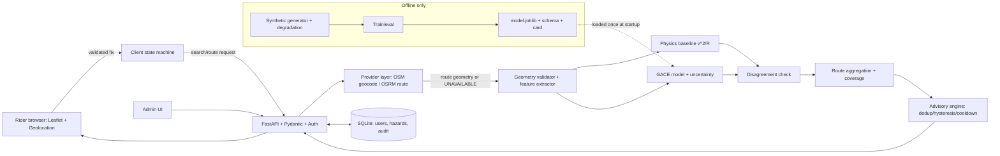

# ROADGUARD AI — FINAL MASTER PLAN (END TO END)

Project dir: `D:\Final_year_Project`
B.Tech CSE (DS & ML) final-year project · C R Rao AIMSCS · Major Project Stage 1 → Review 2 → full build
Supersedes: `ROADGUARD_MASTER_LOOP_PLAN.md` and `ROADGUARD_FEATURES_AND_ML_PLAN_v2.md`

**One-line definition:** a real-time, mobile-first road-geometry advisory app that uses a **synthetic-trained, degradation-robust ML estimator** (with a transparent physics baseline) to score upcoming curve/route geometric challenge, with honest evidence provenance. **No real accident data. No accident prediction claims.**

---

## 0. RULES THAT NEVER CHANGE

| # | Rule | Check |
|---|---|---|
| R1 | No fabricated papers, DOIs, metrics, feedback, results, routes, GPS, weather, traffic | Every number traceable to a logged command; every citation verified at publisher |
| R2 | No historical accident CSV, fake blackspots, invented crash data | `grep -ri "accident.*csv\|blackspot"` on runtime code = 0 |
| R3 | No silent fallbacks. Failure → typed `UNAVAILABLE` / `insufficient_evidence` | provider-failure + missing-model tests |
| R4 | Geometry score ≠ accident probability (UI, API, docs) | CI string audit blocks: `accident probability`, `safe route`, `prevents accidents`, `validated risk` |
| R5 | Missing segments are never scored as zero-risk | aggregation test |
| R6 | Unverified community reports never labelled confirmed | hazard lifecycle test |
| R7 | Every rider-facing safety statement has an evidence source or "advisory" label | UI audit |
| R8 | No secrets in repo, DOM, logs | secret scan |
| R9 | Never weaken/delete meaningful tests to get green | diff review on `tests/` |
| R10 | Synthetic data never presented as real observations; training code never imported by runtime server | import-graph test |
| R11 | Unknown student info → write `REQUIRES STUDENT INPUT` | doc review |

**Meaning of "verified":** verified as a *correct, robust geometry-challenge estimator* (physics reference, invariants, robustness sweeps, reproducibility). **Not** verified to predict or prevent accidents.

---

## 1. THE LOOP (runs until §14 exit gates are all green)

```
LOOP:
 1 READ    docs/LOOP_STATE.md
 2 AUDIT   git status → full test suite → record actual output
 3 PICK    lowest phase whose gate is not green
 4 PLAN    ≤10 small tasks
 5 BUILD   one task at a time (no mass rewrites/deletes)
 6 TEST    unit → integration → e2e for touched area; then full suite
 7 FIX     regressions (never weaken tests)
 8 DOC     update docs with ACTUAL results only
 9 COMMIT  "phase-N: <what>" with tests green
10 GATE    phase checklist green? mark DONE : repeat from 4
11 LOG     append to LOOP_STATE.md
12 CHECK   all §14 gates green? STOP : back to 1
```

- **Blocker rule:** log exact blocker, mark `BLOCKED`, continue independent work, never fake completion.
- **Iteration cap:** 5 failed attempts on one defect → root-cause note in `docs/KNOWN_ISSUES.md`, reduce scope honestly, move on.
- **LOOP_STATE template:** `Iteration n · date · Phase · Status · Tasks done · Commands+actual results · Open defects · Blockers · Next action`

---

## 2. PROBLEM, OBJECTIVES, CONTRIBUTION

**Problem (Existing → Problem → Limitation → Need → Direction):**
Riders use navigation apps that show routes and ETA but not the geometric demand of upcoming curves. Historical crash records are often unavailable, and route geometry alone doesn't establish accident risk. Existing ML curve-safety work typically relies on real telemetry or crash data. There is a need for a transparent, data-free way to estimate and explain geometric challenge, with honest uncertainty. RoadGuard investigates whether a physics-referenced, synthetic-trained estimator can do this robustly from noisy, incomplete mapped geometry.

**Five separated evidence channels (never merged into one score):**
1. Geometry-based challenge estimate
2. Current driving context (only where reliable)
3. Community-reported hazards
4. Verified traffic/environment context (only where available)
5. Accident prediction → **out of scope**

**Objectives (3–5, measurable; thresholds set from measured baseline, not invented):**
1. Build a validated geometry feature extractor passing analytical test cases (radius error within a stated tolerance on synthetic arcs).
2. Build a mandatory synthetic-trained ML estimator and compare it to the physics baseline under noise/missing/coarse inputs (MAE, RMSE, CI).
3. Deliver coverage- and uncertainty-aware route-level aggregation and comparison.
4. Deliver a real-time rider pipeline with measured update latency and zero duplicate GPS subscriptions.
5. Deliver typed unavailable/insufficient-evidence handling with all provider-failure tests passing.

**Contribution (safe wording; claim novelty only after Phase 1 confirms it):**
> A degradation-robust, data-free geometry-challenge estimator: physics reference + synthetic-trained regressor with uncertainty + coverage-aware route aggregation, delivered via a real-time advisory interface with explicit evidence provenance.

Never say: "novel", "first", "predicts accidents", "safer routes".

---

## 3. FEATURE LIST (research basis → gap → solution → evidence channel)

Status key: **V** = source confirmed this session · **P** = named in spec, verify at publisher in Phase 1 · **T** = standard technical doc, verify in Phase 1. A feature ships only when its source is verified and its test passes.

### A. Geometry core
| # | Feature | Research basis | Gap | Solution | Channel |
|---|---|---|---|---|---|
| F1 | Curve detection + radius/heading-change extraction | FHWA-HRT-13-077 **P** | Nav apps show route, not curve demand | Geodesic/projected extractor + quality flags | computed_geometry |
| F2 | Lateral-acceleration demand `v²/R` | Lateral acceleration among most influential curve surrogate measures in a floating-car-data study (Archives of Transport, Czech roads) **V** | Surrogates usually need vehicle telemetry | Physical indicator from mapped geometry + speed band | computed_geometry |
| F3 | Consecutive-curve / transition context | FHWA **P** | Isolated-curve scoring misses sequences | Curvature variation + spacing features | computed_geometry |
| F4 | Grade interaction (only with real elevation) | FHWA curve+grade **P** | OSM lacks reliable grade | Gated on elevation; else `unavailable`, never zero | computed_geometry |

### B. Mandatory ML
| # | Feature | Research basis | Gap | Solution | Channel |
|---|---|---|---|---|---|
| F5 | **Geometry-Aware Challenge Estimator (GACE)** | Tree-based models on curve surrogate measures (Nadimi et al. 2025 **P**, DOI 10.1038/s41598-025-97384-7); ML-vs-statistics on rural curves (Egypt study **V**) | Prior ML uses real telemetry/crash data; polyline-only, data-free, degradation-robust estimation not shown (**confirm in Phase 1**) | Train on synthetic scenarios; test under noise/missing/coarseness | model_estimate |
| F6 | Per-segment uncertainty band | Uncertainty communication **P** | Single numbers hide input quality | RF tree variance / quantile GBM | model_estimate |
| F7 | ML↔baseline disagreement flag | Model-validation practice | Silent model failure | Flag + show baseline when divergence exceeds learned tolerance | model_estimate |
| F8 | Model card + one-command retrain | ML documentation practice **P** | Unreproducible student ML | Seeds, manifest, label version | meta |

### C. Route level
| # | Feature | Gap | Solution | Channel |
|---|---|---|---|---|
| F9 | Route score `Σ(L·S)/Σ(L)` over eligible segments | Missing data treated as zero | Report coverage + missing % | model_estimate |
| F10 | Coverage/uncertainty-aware comparison | Lower score ≠ safer | Score, distance, coverage diffs; `insufficient_evidence` state; never invent alternatives | model_estimate |
| F11 | Top-contributing-sections explainer | Black-box scores | Tree feature contributions in detail view | model_estimate |

### D. Real-time rider
| # | Feature | Research basis | Solution | Channel |
|---|---|---|---|---|
| F12 | GPS fix validation + state machine | MDN/W3C Geolocation **T**; map-matching/GPS uncertainty **P** | Accuracy/staleness/plausibility gates; explicit states | browser |
| F13 | Advance curve advisory (lead distance, dedup, hysteresis, cooldown) | Advisory communication **P** | Rule engine on F2/F5; labelled "advisory" | model_estimate |
| F14 | Deviation detection + stale-response protection | OSRM docs **T** | Cancellation, debounce, bounded cache | provider |
| F15 | Honest routing/ETA/geocoding | OSM licence, OSRM policy **T** | Typed `provider_unavailable`; attribution shown | provider |

### E. Community, admin, privacy
| # | Feature | Solution | Channel |
|---|---|---|---|
| F16 | Hazard reporting (GPS/pin), confirm/withdraw, expiry, audit | Status machine; "unverified" label; admin verify; rate limits | user_submitted |
| F17 | Admin console: health, users, moderation, model status, provenance, diagnostics | Separate compact UI | meta |
| F18 | Privacy-minimal storage + account deletion | No persistent precise trails | meta |

---

## 4. ARCHITECTURE (modular monolith)

- **Backend:** FastAPI + Pydantic · **DB:** SQLite (R-tree only if benchmarked useful) · **Frontend:** Leaflet + vanilla JS · **Browser Geolocation** · **Routing/geocoding:** existing OSRM/OSM integration (after provider terms verification) · **ML:** scikit-learn, joblib
- **No** microservices, brokers, Redis, Kubernetes, separate ML server, second DB, SSE/WebSockets without measured need.

**Layers:** 1 Presentation · 2 Client location/nav state · 3 API validation + auth · 4 Domain services · 5 Geometry/route analysis · 6 ML inference · 7 Community hazards · 8 Persistence · 9 Provider integration · 10 Metrics/diagnostics/audit · 11 Testing/evaluation

**Provenance tags (enforced in schemas):** `provider` · `user_submitted` · `synthetic_experimental` · `computed_geometry` · `model_estimate` · `unavailable`

**Error types:** `invalid_input` · `insufficient_evidence` · `provider_unavailable` · `auth_failure` · `authz_failure` · `model_unavailable` · `internal_error`



---

## 5. REAL-TIME PIPELINE

1 Permission → 2 fix → 3 validate range/timestamp/accuracy → 4 reject stale/implausible → 5 single subscription → 6 update location → 7 route on user request only → 8 provider geometry → 9 validate geometry+metadata → 10 split sections → 11 extract features → 12 score (baseline + GACE) → 13 aggregate → 14 coverage/uncertainty → 15 find upcoming advisories → 16 dedup/hysteresis/cooldown → 17 update UI without rebuilding map → 18 store only necessary data → 19 revalidate on each fix.

**UI states (FSM):** locating · gps_unavailable · gps_uncertain · ready · routing · navigating · advisory_active · route_deviation · insufficient_evidence · provider_unavailable · trip_completed.
Use request cancellation, debouncing, timeouts, stale-response rejection; no full re-route every few seconds without justification.

---

## 6. FEATURE-ENGINEERING SPEC

Features: segment length · heading change · heading change/distance · radius estimate · curve length · curvature variation · consecutive-curve transitions · road class (if available) · junction context (if available) · grade (**only real elevation**) · geometry quality · feature coverage · GPS accuracy · speed (only if reliable).

For each: definition · units · source · formula · valid range · missing-data policy · quality limits.
Handle: duplicate points, degenerate segments, lon/lat swaps, coarse polylines, numerical instability, antimeridian, missing elevation/speed.
Use geodesic/projected math. **Never infer** banking, friction, speed limit, or pavement from an OSM polyline.

---

## 7. SYNTHETIC DATA + MANDATORY ML

### 7.1 Why ML is justified
Label = clean reference score (`a_lat = v²/R` → normalised challenge score). A model that only copies this is pointless, so the target is harder: **estimate the clean score from degraded, real-world-like inputs, with an uncertainty band.** The baseline breaks under noise/missing inputs; ML learns denoising, imputation, speed-uncertainty marginalisation.
- Allowed claim: "more accurate than the baseline under input degradation (measured)".
- Forbidden: any statement about crashes, injury, or real safety outcomes.

### 7.2 Generator (`ml/synthetic/`, offline only)
- Scenarios: straight, simple arc, spiral transition, reverse (S) curve, compound, hairpin, urban turn
- Fixed-seed sampling: radius 15–2000 m (log-uniform), arc angle, segment length, speed band, road class, optional grade
- Clean label `score = f(a_lat, curve length, transition, optional grade)`; every coefficient/threshold documented with source or "engineering assumption"
- Degradation operators (inputs only): coarse sampling, Gaussian GPS-like noise (σ sweep), vertex dropout, missing speed/class/grade, duplicate points
- Versions: `generator_v1`, `label_v1`; manifest with hashes

### 7.3 Models (all compared)
1 Reference baseline on degraded inputs · 2 `DecisionTreeRegressor` · 3 `RandomForestRegressor` · 4 `HistGradientBoostingRegressor` with monotonic constraints (radius↓⇒score↑, speed↑⇒score↑).
Production = best on degraded holdout that passes invariants; others kept as ablations.

### 7.4 Splits (no leakage)
Split by scenario ID / parameter region (hold out whole radius bands and scenario types) · separate OOD test (radius/speed outside training range) · real OSM/OSRM polylines used only for plausibility checks (no labels, no accuracy claims).

### 7.5 Verification suite
| Check | Pass criterion (set from measured baseline) |
|---|---|
| Clean-holdout MAE/RMSE | ≤ baseline + stated margin |
| Noise-sweep MAE/RMSE | **ML < baseline** (justification test) |
| Missing-feature sweep 0–100% | graceful degradation; `unavailable` below threshold |
| Monotonicity + unit invariants | 100% on grid tests |
| OOD radius/speed | error reported; band widens |
| Per road category | no unreported failure |
| Uncertainty calibration | empirical coverage vs nominal |
| Feature importance sanity | R and v dominate, matching physics |
| Seed stability | ≥5 seeds, mean ± CI |
| Latency + artifact load | p50/p95 measured |
| Leakage audit | scripted: zero scenario overlap |

**If ML fails the noise test:** it stays in the pipeline (compulsory), the report says so plainly, runtime serves baseline with ML in shadow mode. Never hide it.

### 7.6 Artifacts + runtime
`model.joblib` · `feature_schema.json` · `train_config.yaml` · `dataset_manifest.json` · `label_version.txt` · `eval_results.json` · `MODEL_CARD.md` · `REPRODUCE.md` (`make train && make eval`).
Load once at startup · missing artifact → `model_unavailable` + baseline labelled `baseline` · every ML output tagged `model_estimate` · synthetic origin disclosed in detail view.

---

## 8. COMMUNITY HAZARDS, ADMIN, SECURITY, PRIVACY

- **Hazards:** current-location + map-pin reports, categories, timestamp, status (`unverified`/`verified`/`rejected`/`expired`), confirm/withdraw, admin verify, expiry, audit trail; block bad coords, duplicates, unauthorised verify, rate abuse.
- **Admin (separate UI):** health, users, moderation, config, model status, provenance, diagnostics.
- **Security:** password hashing, secure tokens, server-side authz, validation, rate limits, safe errors, secrets via env, dependency audit (`pip-audit`).
- **Privacy:** minimal data, no persistent precise movement trails, account deletion, no tokens in DOM/logs. Document limits in `SECURITY_AND_PRIVACY.md`.

---

## 9. UI SPEC

Map-first, mobile-first, minimal, restrained colour, clean type, large touch targets, reduced-motion support.
- **Main screen:** top bar (RoadGuard, GPS chip, profile) · map · destination search · locate · route card (distance, provider ETA) · small advisory card
- **Navigation:** next manoeuvre, remaining distance/ETA, compact advisory, recenter, end
- **Secondary only:** report hazard · route comparison · trip summary · settings/privacy · technical detail view (scores, provenance, uncertainty)
- **Not shown to ordinary riders:** raw internal scores
- **Test widths:** 320 / 360 / 390 / 430 / tablet / desktop (save screenshots; claim real-device testing only if done)
- **A11y:** keyboard, visible focus, ARIA labels, contrast, reduced motion
- **Standard wording:** "Geometry challenge indicator — not an accident probability." · "No data available for this section." (never "safe") · "Community report — unverified." · "Advisory based on mapped road shape; real conditions may differ." · "Traffic information unavailable."

---

## 10. PHASES AND GATES

| Phase | Work | Gate |
|---|---|---|
| **0 Audit** | `git status/log`; back up DB + community/audit data (verify restore); map repo; run tests; start app + `/health`; confirm R2; find dead/duplicate code. Output `docs/PROJECT_AUDIT.md` with feature inventory (feature · files · endpoints · DB · providers · tests · status · limits · action; statuses: Implemented&tested / Incomplete tests / Partial / Mocked / Unavailable / Dead / Not implemented) | Audit doc · baseline output saved · restore verified · R2 confirmed |
| **1 Research** | Verify + read sources (FHWA-HRT-13-077, Nadimi 2025, telematics surrogate-measure and harsh-event papers, proactive curve-assessment papers, OSM/ODbL, OSRM docs, MDN Geolocation, map-matching, synthetic-data limits, spatial CV/leakage, uncertainty communication, interpretable tabular ML). Per paper: question · method · data used · evaluation · findings · limitations · relevance · what it does NOT establish. Comparison table; gap; problem statement; objectives. Do not assume results generalise to Indian roads | Every citation verified (URL + date) · gap→method chain logical |
| **2 Contracts** | Architecture + diagram; OpenAPI from real FastAPI; schemas with provenance + typed errors; DB retention, ER diagram, indexes, migration | OpenAPI generated · migration dry-run on DB copy loses 0 rows |
| **3 UI/Auth/Nav shell** | Rider UI, FSM, auth, admin shell, a11y | FSM tests · layouts at all widths · authz tests |
| **4 Geometry** | GPS validation, geometry validation, feature extractor, advisory logic | Analytical cases (known-radius arcs, straights, S-curves, noisy lines) · numerical stability · dedup/cooldown tests |
| **5 Route-level** | Aggregation, coverage, comparison, insufficient-evidence | Missing-segment, single-route, low-coverage tests |
| **6 Baseline** | `v²/R` score; evaluate on clean **and degraded** inputs (the bar ML must clear); invariants | Spec doc · invariants pass · measured results table |
| **7 ML (mandatory)** | Generator → degradation → 4 models → §7.5 suite → artifacts + model card | All checks reported · reproducible from clean checkout |
| **8 ML integration (mandatory)** | Load at startup, uncertainty, disagreement flag, admin model status, provenance in API | Load test · missing-artifact test · tags in API · import-graph test |
| **9 Hazards/admin/privacy/security** | §8 | Lifecycle · authz matrix · secret scan · account deletion |
| **10 Performance** | Measure first (GPS rate, route-request rate, eval latency, render cost, markers, listeners, cache size, `EXPLAIN QUERY PLAN`, model latency, memory soak) → then bounded cache, map-object reuse, cancellation, debounce, stale rejection, indexes | `PERFORMANCE_REPORT.md` with workload + p50/p95 · no duplicate listeners · flat memory |
| **11 Regression** | Unit, integration, frontend, e2e (startup, search→route, nav lifecycle, curve advisory, hazard submit, insufficient evidence, provider failure); ruff + mypy/pyright + JS lint; mocks labelled `mock`, live tests labelled `live` | Green or failures documented with root cause |
| **12 Docs + Review 2 package** | §11 | Docs match code · every number traceable |
| **13 Deployment** | Dockerfile (non-root, healthcheck), env profiles, HTTPS reverse-proxy docs, CORS + headers, JSON logs without PII, `/health` + `/ready`, GitHub Actions (lint→types→tests→audit→build), backup/restore, migration runner with rollback, OSM attribution, OSRM public-demo limits respected (self-host/commercial routing plan before public launch), runbook | Clean-machine deploy from README · CI green · restore proven |

---

## 11. DOCUMENTATION DELIVERABLES

`docs/`: PROJECT_AUDIT · ARCHITECTURE · RESEARCH_LITERATURE_REVIEW · RESEARCH_GAP_AND_CONTRIBUTION · REVIEW_2_PROJECT_SPECIFICATION · GEOMETRY_ML_DESIGN · GEOMETRY_ML_LIMITATIONS · DATA_AND_PROVENANCE · API_SPECIFICATION · DATABASE_DESIGN · SECURITY_AND_PRIVACY · TESTING_AND_EVALUATION · PERFORMANCE_REPORT · LIMITATIONS · IMPLEMENTATION_STATUS · REFERENCES_VERIFIED · KNOWN_ISSUES · LOOP_STATE · MODEL_CARD
Plus: README (exact setup), pinned `requirements.txt` (tested versions), `.env.example`, migration/test/train instructions, demo script.
Each methodology component documented as **WHAT / WHY / HOW / EVALUATION**.

---

## 12. TESTING MATRIX

| Level | Covers |
|---|---|
| Unit | geometry math, features, GPS validation, alert logic, aggregation, hazard validation, generator, labels, model input validation, inference |
| Integration | API schemas, provider integration (live-labelled), DB, auth, hazard lifecycle, nav/deviation, model artifact loading |
| Frontend | JS syntax, FSM, GPS lifecycle, stale-response, route state, alert render, responsive checks |
| E2E | startup, search→route, nav lifecycle, curve advisory, hazard submit, insufficient evidence, provider failure |
| Non-functional | latency, memory soak, duplicate-request rate, GPS error handling |

Record exact commands + actual output in `TESTING_AND_EVALUATION.md`. Never describe mocked tests as live-provider tests.

---

## 13. REVIEW 2 PACKAGE (college 21-slide structure)

| # | Slide | Source | Status |
|---|---|---|---|
| 1 | Title (team, supervisor) | **REQUIRES STUDENT INPUT** | ☐ |
| 2 | Project overview | REVIEW_2_PROJECT_SPECIFICATION | ☐ |
| 3 | Review 1 feedback + actions (actual only) | **REQUIRES STUDENT INPUT** | ☐ |
| 4 | Refined problem statement | §2 / Phase 1 | ☐ |
| 5 | Objectives | §2 | ☐ |
| 6 | Updated literature review | Phase 1 | ☐ |
| 7 | Comparative analysis table (Paper · Year · Method · Data · Performance as reported · Limitation; row for Proposed: "to be evaluated") | Phase 1 | ☐ |
| 8 | Research gap | Phase 1 | ☐ |
| 9 | Proposed contribution | §2 | ☐ |
| 10 | Detailed methodology | §5–7 | ☐ |
| 11 | Architecture diagram | §4 | ☐ |
| 12 | Dataset / synthetic methodology | §7 | ☐ |
| 13 | Tools & technologies (each with a role) | §4 | ☐ |
| 14 | Baseline approach | Phase 6 | ☐ |
| 15 | Initial implementation progress | repo evidence | ☐ |
| 16 | Preliminary results (measured only; else "Implementation is in progress") | Phases 6/10 | ☐ |
| 17 | Evaluation strategy | §7.5 | ☐ |
| 18 | Current status table | IMPLEMENTATION_STATUS | ☐ |
| 19 | Remaining work + timeline | LOOP_STATE | ☐ |
| 20 | Expected outcome | Phase 12 | ☐ |
| 21 | References (verified) | REFERENCES_VERIFIED | ☐ |

Status vocabulary: Completed · Tested · In progress · Planned · Unverified.
Every team member must answer the guideline's 20 viva questions (problem, literature, method, data, implementation, evaluation). Be able to explain every graph/number you show: how generated, what it means, why it changed, whether reliable.

---

## 14. EXIT GATES (loop stops only when ALL true)

- [ ] Gates 0–13 green
- [ ] Rules R1–R11 pass
- [ ] ML pipeline present, reproducible, honestly evaluated; no accident-prediction claim anywhere
- [ ] Full test suite green, or each failure documented with root cause
- [ ] Clean-machine deploy from README works; CI green
- [ ] All docs match code; all references verified
- [ ] Review 2 checklist complete except `REQUIRES STUDENT INPUT` items
- [ ] Final report (§15) written with actual numbers only

"Perfect" is not claimable. Completion = every gate evidenced.

---

## 15. FINAL REPORT FORMAT

1 Executive summary · 2 Architecture · 3 Research findings + verified refs · 4 Gap + contribution · 5 Implemented modules · 6 Removed modules + reasons · 7 Dataset + synthetic methodology · 8 Baseline vs model evaluation · 9 Actual metrics + interpretation · 10 API + DB summary · 11 UI summary · 12 Security/privacy checks · 13 Test commands + results · 14 Performance · 15 Known limitations · 16 Remaining work · 17 Review 2 checklist · 18 Exact local run commands

---

## 16. KICKOFF PROMPT (paste into Claude Code)

```
Read ROADGUARD_FINAL_MASTER_PLAN.md in D:\Final_year_Project.
Execute the LOOP in §1 starting at Phase 0. Obey rules R1–R11. Never fabricate data,
citations, metrics, feedback, or results. The ML estimator (Phase 7–8) is mandatory and
trained on synthetic data only; make no accident-prediction claims. After each iteration
update docs/LOOP_STATE.md with actual commands and outputs. Do not stop to ask unless
blocked on student-only information; log the blocker and continue independent work.
Stop only when all §14 exit gates are green with evidence, then write the Final Report.
```

---

## 17. STUDENT INPUTS STILL REQUIRED
Team members + supervisor · actual Review 1 feedback · internal guide's suggestions · Review 2 date/slide limits · **guide's written confirmation that the synthetic-only, mandatory-ML scope is acceptable**.
